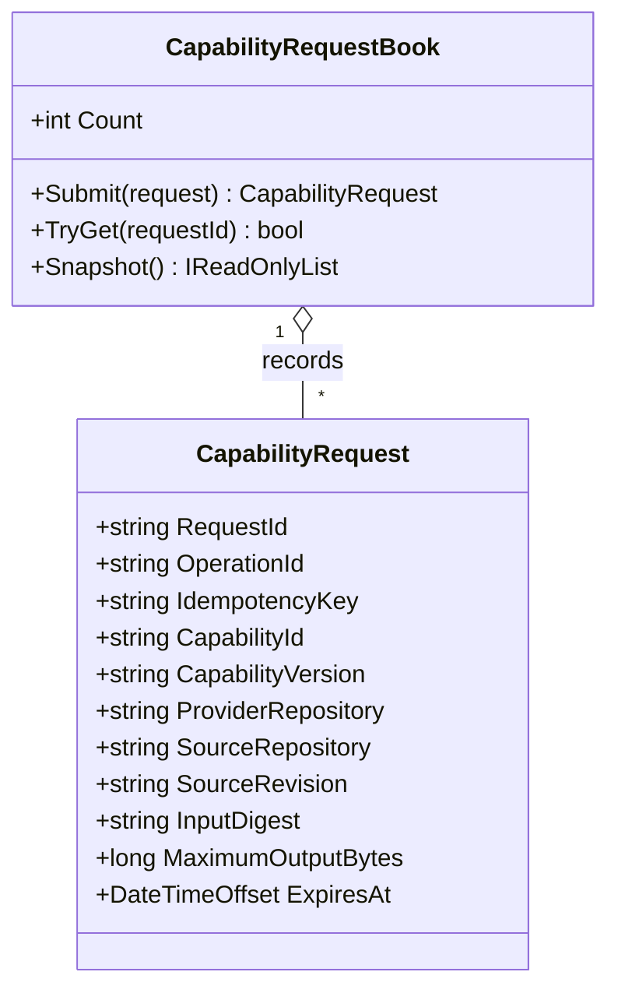

# CapabilityRequestBook UML and Use Case

**Owner moniker:** The Singularity Workshop  
**Purpose:** record a bounded request and make identical retries safe within the current process.

## Use case

1. Coordinator supplies an authorized, pinned request.
2. CogB validates bounds and immutable input identities.
3. First submission records the request.
4. An identical retry returns the original request; changed inputs under the same idempotency identity are rejected.
5. A separate dispatcher may later execute only after policy and provider controls pass.

The in-memory ledger is not durable and does not prove provider execution.