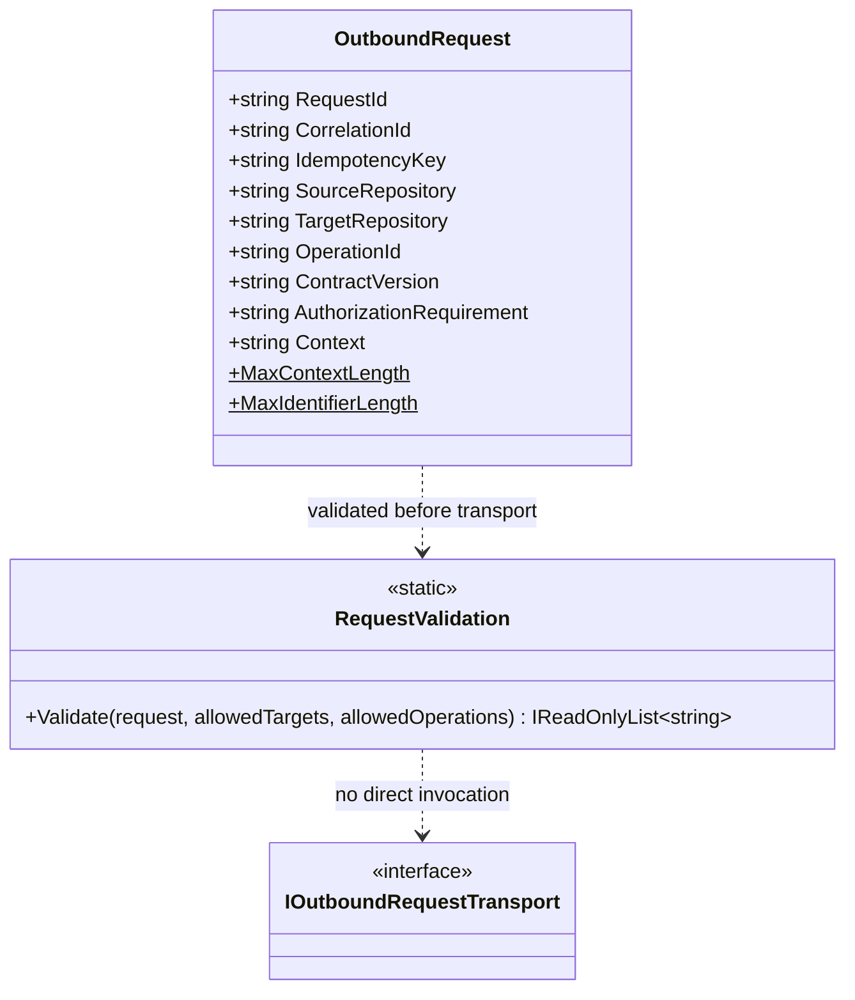

# RequestValidation — UML Class Card and Use Case

**User moniker:** CogB Outbound Request Boundary

## Use case: prepare a bounded request

1. A trusted host constructs `OutboundRequest` and supplies target and operation allowlists.
2. `RequestValidation.Validate` checks identifiers, canonical repository shape, strict contract version, context bounds, target membership, and source/target separation.
3. Any error code blocks the host from proceeding.
4. The host separately applies authorization and chooses a transport.

## Boundary

CogB validates request shape and allowlist membership. It does not grant authorization, perform network I/O, dispatch an operation, or prove a remote result.
