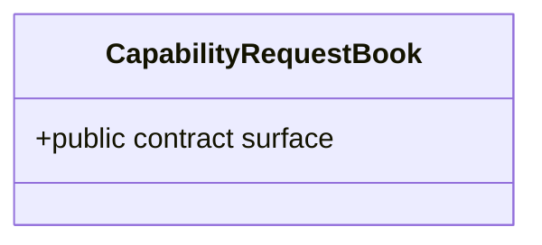

# CapabilityRequestBook

**Owner moniker:** The Singularity Workshop  
**Purpose:** create and record bounded requests with pinned inputs and process-local idempotency conflict detection.

## Responsibility

Create and record bounded requests with pinned inputs and process-local idempotency conflict detection. The class provides a bounded, dependency-free control-plane primitive. It does not perform remote execution, grant implicit permission, or replace authoritative provider evidence.

## UML class card

For the focused class diagram and use case, see [CapabilityRequestBook UML](../../docs/UML/CapabilityRequestBookUML.md).
